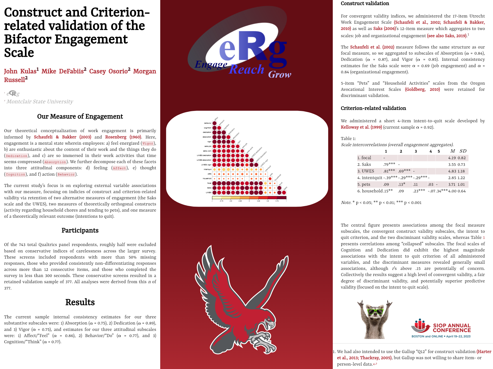
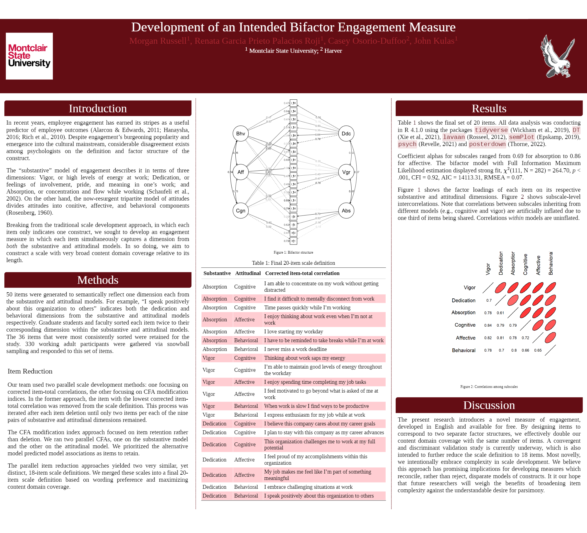

**Conferences:** Society for Industrial and Organizational Psychology (SIOP) Annual Conference, Seattle 2022 & Boston 2023
**Collaborators:** John Kulas, Morgan Russell, Renata Garcia Prieto Palacios Roji, Mike DeFabiis
**Code:** [heyimMIKE123/Engagement-Survey-Projects](https://github.com/heyimMIKE123/Engagement-Survey-Projects) · [Technical report](https://bookdown.org/kulasj/engagetech/)

## The idea

Researchers usually describe engagement in one of two ways: by *substance* (Vigor, Dedication, Absorption) or by *attitude* (what you Think, Feel, and Do). Instead of picking one, our team wrote items that measure **both at once**. Each item maps to one substantive and one attitudinal dimension, which gives broad coverage of the construct with a short survey.

## SIOP 2023: Construct and criterion-related validation

{.lightbox fig-alt="SIOP 2023 poster: Construct and Criterion-related validation of the Bifactor Engagement Scale"}

- Gave the scale to a Qualtrics panel alongside two established engagement measures (UWES and Saks), an intent-to-quit scale, and two unrelated "discriminant" scales (pets, household activities)
- Screened out careless responders (excessive missing data, straight-lining, speeding), keeping 377 of 743 respondents
- Found strong convergent validity (*r* = .79 with Saks, .81 with UWES) and a meaningful negative link to intent to quit (*r* = −.39)

[Download the 2023 poster (PDF)](siop-2023-poster.pdf){.btn .btn-outline-primary}

## SIOP 2022: Developing the measure

{.lightbox fig-alt="SIOP 2022 poster: Development of an Intended Bifactor Engagement Measure"}

- Wrote 50 items, then kept the 36 that graduate students and faculty sorted most consistently
- Collected responses from 330 working adults through snowball sampling
- Reduced to 20 items using two parallel methods: corrected item-total correlations and CFA modification indices
- The bifactor model fit well: CFI = 0.92, RMSEA = 0.07; subscale alphas ranged from 0.69 to 0.86

[View the 2022 poster as a web page](https://casosorio.github.io/SIOP-2022/){.btn .btn-outline-primary}

## Tools

R: `tidyverse`, `lavaan` (CFA/bifactor models), `semPlot`, `psych`, `DT`, and `posterdown` for the posters themselves.
